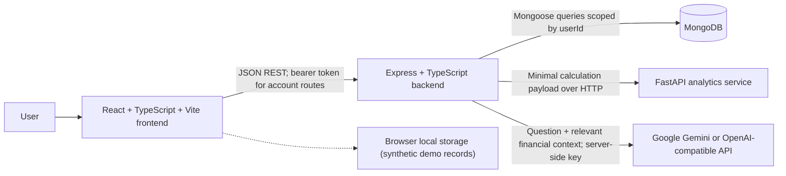
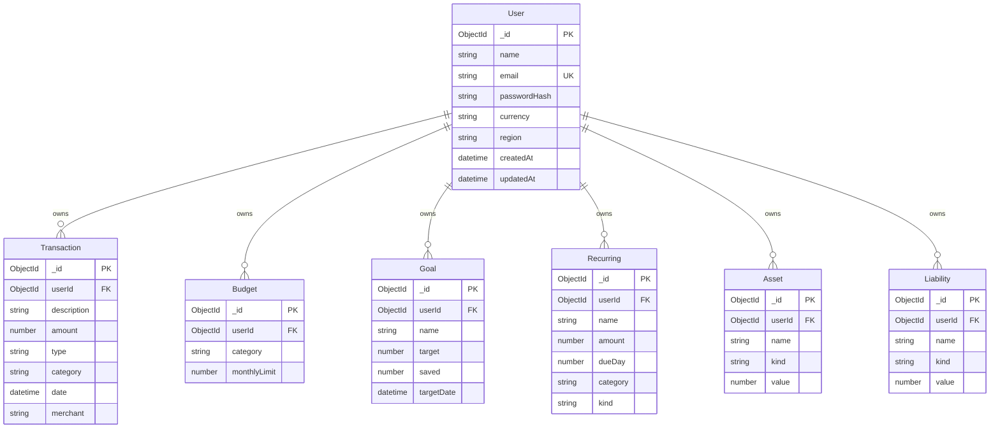
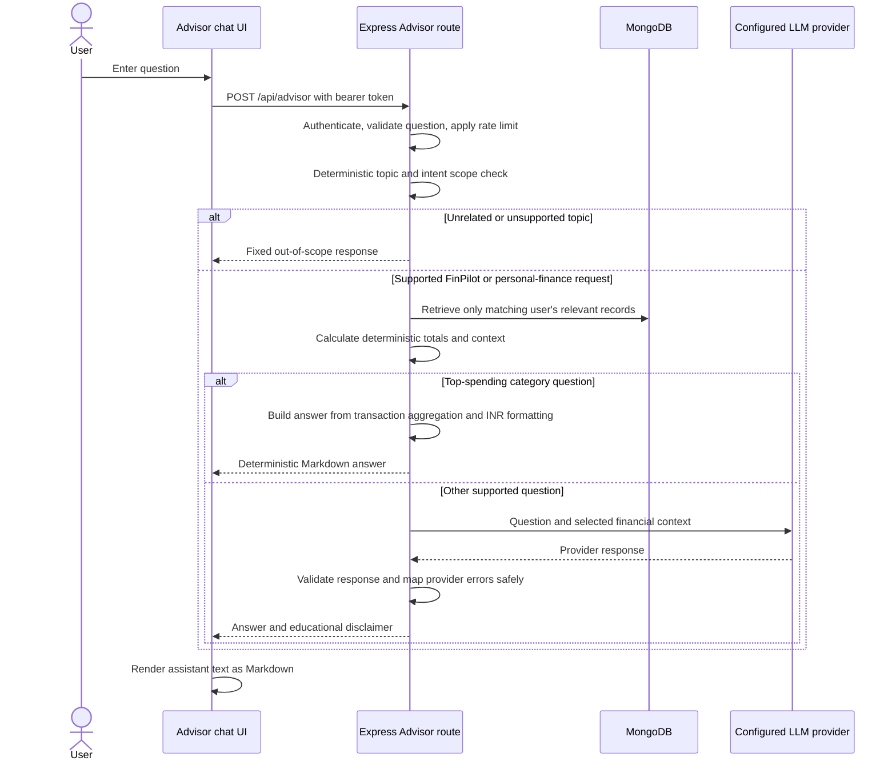

# FinPilot AI — System Architecture

**Document version:** 1.0  
**Project:** FinPilot AI — AI-Powered Personal Finance Management System  
**Prepared for:** College project evaluation and technical review  
**Last reviewed:** 18 October 2026

## 1. System overview

FinPilot AI is a browser-based personal finance application with three independently running services: a React/Vite frontend, an Express/TypeScript API, and a Python/FastAPI analytics API. MongoDB stores registered account profiles and financial records. An optional server-side LLM adapter provides Advisor responses through Google Gemini or an OpenAI-compatible chat-completions endpoint.

The frontend is the system's only user interface. It calls the Express backend over JSON REST APIs. The backend authenticates account requests, validates input, applies user ownership filters, computes selected financial totals, and calls analytics or an LLM where the selected feature requires it. The analytics service has no direct MongoDB connection: it receives only the analysis payload sent by the backend. No browser-to-database, browser-to-LLM, or real-time socket connection is implemented.

### 1.1 High-level architecture



For local development, the frontend defaults to `http://localhost:4000` for the backend. Express defaults to port `4000`, analytics is normally started on `127.0.0.1:8000`, and Vite uses port `5173`. These are development defaults, not a production deployment topology.

## 2. Components and responsibilities

| Component | Responsibilities | Data it owns or receives |
|---|---|---|
| `frontend/` | Landing/authentication views; responsive dashboard; account and demo mode switching; transaction, budget, goal, asset and liability forms; forecast/insights views; Advisor chat and Markdown rendering; profile editing and export actions | Demo records in browser local storage; a session token in browser local storage; account data fetched from backend APIs |
| `backend/` | REST routes; bcrypt password hashing; JWT issue/validation; Zod request validation; ownership checks; MongoDB persistence; monthly dashboard/calculation logic; Advisor scope gate and context retrieval; analytics and LLM HTTP adapters; export/import endpoints | User-owned MongoDB records and server-side environment configuration |
| MongoDB | Account profile and financial record persistence | `User`, `Transaction`, `Budget`, `Goal`, `Recurring`, `Asset`, and `Liability` documents |
| `analytics/` | Validated transparent summaries, baseline forecast, categorization rules, recurring/unusual-spending screens, what-if and emergency-fund calculations | Request payloads passed by the caller; no database state |
| Gemini/OpenAI-compatible provider | Optional natural-language response generation from the authenticated user's question and selected context | Only a request-specific context selected by the backend; provider credentials are server-side |

The browser's client-side Markdown renderer handles assistant text. It does not run AI inference or calculate private account totals.

## 3. Architecture decisions

1. **Separate the user interface, application API, and analytics API.** The frontend cannot connect directly to MongoDB. Python calculations remain behind a JSON HTTP contract.
2. **Keep account and demo data distinct.** Demo interactions use a separate browser store and do not write to MongoDB. Account data flows through authenticated backend routes.
3. **Use deterministic calculations for financial facts.** The backend calculates monthly transaction totals, category totals, budget spending, and net worth. The AI provider is used to phrase an answer, not to supply database facts.
4. **Restrict the Advisor before retrieval.** A deterministic backend topic/intent matcher runs before database retrieval and provider calls. Unknown or clearly unrelated questions receive a fixed refusal.
5. **Use transparent baselines.** The analytics service exposes its rules and limitations and reports that no trained model is loaded.
6. **Keep the deployment simple for a student project.** Services are started independently from PowerShell. There are no Docker, Kubernetes, CI, or infrastructure-as-code files in the repository.

## 4. Authentication and request/data flow

Registration validates the name, email, and password; requires MongoDB and a valid server-side `JWT_SECRET`; normalizes the email; hashes the password with bcryptjs at cost factor 12; persists the profile; and issues a JWT with a 12-hour expiry. Login compares the supplied password with the stored hash and issues the same kind of token. The browser stores the token in local storage and restores the profile through `GET /api/profile` on reload. Logout removes the browser session. There is no server-side refresh-token or revocation store.

Every private Express route uses bearer-token middleware. The middleware verifies the JWT, reloads the user's profile from MongoDB, and attaches the current user identity to the request. Each user-specific query filters by that authenticated `userId`. Create routes assign `userId` on the server; clients cannot choose another owner. Update/delete routes query by both record ID and `userId`, returning not found for another user's record.

```mermaid
sequenceDiagram
    actor User
    participant Browser as React frontend
    participant API as Express backend
    participant Mongo as MongoDB
    User->>Browser: Submit registration or login form
    Browser->>API: POST /api/auth/register or /api/auth/login
    API->>API: Validate payload and JWT_SECRET configuration
    API->>Mongo: Verify/create user; bcrypt password hash
    Mongo-->>API: User record
    API-->>Browser: JWT (12-hour expiry) and profile
    Browser->>Browser: Store session token in local storage
    Browser->>API: Private request with Authorization: Bearer JWT
    API->>API: Verify token; reload user identity
    API->>Mongo: Query/update records filtered by authenticated userId
    Mongo-->>API: Owned records only
    API-->>Browser: JSON response
```

Demo Mode uses client-side synthetic seed records and browser local storage. Its transactions, budgets, goals, assets, and liabilities are separate from authenticated records. Account and demo state are not merged. The backend has a demo acknowledgement route, but the interactive demo store is implemented in the frontend.

## 5. Database entities and relationships

Mongoose schemas are declared in `backend/src/server.ts`. Each financial collection stores an indexed `userId` reference to the `User` collection. These are logical ownership relationships; the schema does not define MongoDB foreign-key constraints or cascade deletes.



`User.email` is unique and indexed. The `userId` field on financial documents is indexed. All schemas use Mongoose timestamps. A goal contribution is applied atomically with `$inc` to `Goal.saved`; there is no separate contribution-history collection. The `Recurring` model supports reads, while recurring-payment insights are also inferred from repeated transaction descriptions by analytics.

## 6. Financial calculations and analytics interaction

The backend calculates the Overview's current-month income and expenses using Asia/Kolkata month boundaries. Savings are income less spending; the savings rate is unavailable when no income is recorded. Category totals are based on expense transaction records. Budget progress matches current-month expense categories to budget categories. Net worth is total recorded assets minus total recorded liabilities. In authenticated mode, an empty asset/liability list is represented in the UI as not yet recorded; the app does not seed account balances.

The backend sends analytics request payloads to the URL in `ANALYTICS_URL` (default `http://localhost:8000`). It optionally sends the `x-api-key` header when `ANALYTICS_API_KEY` is configured. The Python service independently validates its request models. Its API-key check is disabled when no expected key is set, so it should be protected through environment configuration and network boundaries outside a trusted local development setup.

Implemented analytics methods include:

- **Summaries:** Pandas grouping by parsed month; income, expenses, and savings rate.
- **Forecast:** mean historical net cash flow with an approximate range based on sample standard deviation; reports uncertainty/limitations and no trained model.
- **Categorization:** transparent keyword matching against merchant/description and category terms.
- **Recurring payments:** repeated expense descriptions with approximately monthly date gaps.
- **Unusual spending:** robust median-deviation review prompts when a category has sufficient records; not fraud detection.
- **What-if and emergency fund:** direct calculations with explicit assumptions and limitations.

Backend endpoints currently invoke the analytics summary, forecast, recurring-payment, and unusual-spending operations. The categorization, what-if, and emergency-fund routes are available on the analytics service but are not connected to a dedicated frontend workflow.

## 7. AI Advisor workflow



The backend scope gate is a deterministic phrase/intent matcher in `backend/src/advisorScope.ts`. It permits supported personal finance data and FinPilot workflow questions, and rejects recognized unrelated topics before any financial record query or LLM request. Unknown phrasing may be rejected; the gate is not a semantic model.

For accepted questions, the route inspects the question to decide which user-owned transaction, budget, goal, asset, or liability records to retrieve. Transaction dates are filtered by the requested India calendar month. The backend computes monthly totals/category totals and net worth using deterministic functions in `backend/src/advisorFinance.ts`. The “highest spending category this month” answer is returned directly without an LLM call. Other in-scope requests are sent through the configured provider adapter. Google Gemini uses the `generateContent` endpoint and `x-goog-api-key`; OpenAI-compatible mode uses a chat-completions endpoint and bearer authorization. API keys are not returned to the client.

The AI prompt treats transaction descriptions as untrusted content and instructs the model to use only supplied financial context, distinguish recorded facts from estimates, and avoid inventing figures. The route validates provider success/response shape and maps timeout, configuration, authentication, quota, and malformed-response cases to safe messages. No embeddings, vector database, retrieval-augmented generation (RAG), persistent chat-history endpoint, or live model training is implemented. The browser holds current chat messages in memory only.

## 8. Security and privacy controls

- Passwords are bcrypt-hashed; raw passwords are not stored.
- Real authentication requires a configured strong `JWT_SECRET`; there is no production fallback secret.
- Private routes require a signed bearer JWT and a user profile that still exists in MongoDB.
- User-owned reads and mutations filter by authenticated `userId`; backend tests exercise cross-user resource access.
- Zod validates Express request bodies. Pydantic validates analytics request bodies.
- Helmet sets common security headers. CORS is restricted to configured `FRONTEND_ORIGIN` values (default local Vite origin).
- Authentication is rate-limited to 25 requests per 15 minutes per limiter key; Advisor requests are limited to 12 per minute.
- Express JSON bodies are limited to 1 MB. Unexpected errors return generic messages; logs do not include request bodies, tokens, keys, or financial values.
- Demo data remains in browser storage. It is synthetic and not persisted to MongoDB.
- Session JWT storage is local storage, not an HttpOnly cookie. Application-managed encryption at rest and end-to-end encryption are not implemented.
- The analytics shared key is optional and provides service-level gating only when explicitly configured. It is not user authentication.

## 9. Configuration and development deployment

The backend loads `backend/.env` through `dotenv/config` when launched by the existing npm workspace script. `backend/.env.example` documents supported backend variables. `MONGODB_URI` defaults in code to `mongodb://127.0.0.1:27017/finpilot` when absent; account registration requires a reachable MongoDB and valid JWT secret.

The frontend reads `VITE_API_BASE_URL` at build time and defaults to `http://localhost:4000`. The repository does not include a frontend `.env.example`.

The analytics service reads `ANALYTICS_API_KEY` from its process environment using Python `os.getenv`; it does not load `analytics/.env.example` automatically. The local Uvicorn command sets host and port explicitly. For optional service-key protection, configure the same value in the backend process (`backend/.env`) and analytics process environment.

Local development service order:

1. Start MongoDB.
2. Start FastAPI on `127.0.0.1:8000`.
3. Start Express on port `4000`.
4. Start Vite on port `5173` and open the browser.

Exact PowerShell commands and setup steps are maintained in the repository [README](../README.md).

## 10. Known limitations and future improvements

- No bank integrations, bank credential collection, account aggregation, money transfers, or investment orders.
- No persistent Advisor conversation history or user-editable chat archive.
- Local storage token persistence is less resilient to XSS than secure HttpOnly cookies; production should consider cookie-based sessions, CSRF protection, rotation/revocation, HTTPS, and a deployment-specific threat review.
- Advisor scope matching is deterministic and can reject natural phrasing it does not recognize. Regression tests cover supported paraphrases and common unrelated questions.
- No formal semantic grounding verification of free-form LLM claims exists beyond scoped context, deterministic calculations, prompt constraints, and response validation.
- CSV preview and commit routes exist, but there is no browser import workflow.
- The Recurring model has a list route but no UI or CRUD workflow. A separate analytics pattern detector flags repeated transaction descriptions.
- Forecast output is a baseline estimate; transaction-only history can omit months without records and backend forecast history is bounded to 3,000 transaction rows and a recent time window.
- Analytics functions for categorization, what-if simulations, and emergency-fund projections lack dedicated UI workflows.
- No production deployment files, automated CI configuration, admin interface, or license file is present.

Potential future work includes a CSV import interface, secure cookie sessions, persisted Advisor history, explainability/evaluation for provider answers, an authorized financial-data integration, analytics UI workflows, and deployment automation.
